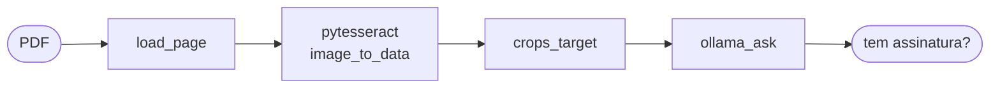

# signature-pipeline

Pipeline de linha de comando que recebe um documento em PDF, recorta a região
da assinatura com o **Tesseract** e pergunta a um modelo de visão no **Ollama**
se o recorte tem assinatura manuscrita.

> Esqueleto: as funções têm só a assinatura e `pass`. A docstring de cada uma
> diz o que ela deve fazer.

## Fluxo



1. `load_page`: abre a página do PDF como imagem.
2. `pytesseract.image_to_data`: lê as palavras e as posições delas (conferir com `show_box`).
3. `crops_target`: acha a âncora ("Diretora") e recorta a região acima dela.
4. `ollama_ask`: envia o recorte ao `qwen2.5vl:3b`.
5. `SignatureDetection`: valida a resposta `{"has_signature": true/false}`.

## O que implementar

| Arquivo | Funções |
|---------|---------|
| `src/signature_pipeline/tesseract_service.py` | `load_page`, `show`, `show_box`, `box`, `normalize`, `crops_target` |
| `src/signature_pipeline/ollama_service.py` | `ollama_ask` |
| `src/signature_pipeline/main.py` | `main` (junta tudo, os passos estão na docstring) |
| `src/signature_pipeline/schemas.py` | já pronto (`SignatureDetection`) |

## Requisitos

```bash
# Tesseract com português
sudo apt install -y tesseract-ocr tesseract-ocr-por

# Ollama e o modelo de visão
curl -fsSL https://ollama.com/install.sh | sh
ollama pull qwen2.5vl:3b

# uv
curl -LsSf https://astral.sh/uv/install.sh | sh
```

## Como rodar

```bash
uv sync
cp /caminho/do/certificado.pdf documentos/certificado.pdf
uv run signature-pipeline
```

O documento de entrada é `PATH` e a pasta dos recortes é `RECORTES_DIR`,
ambos em `main.py`. As pastas `documentos/` e `recortes/` ficam fora do Git,
porque guardam documentos reais.

Para verificar o código:

```bash
uv run ruff check
```

## Estrutura

```
signature-pipeline/
├── documentos/                 # PDFs de entrada (fora do Git)
├── pyproject.toml              # dependências e o comando signature-pipeline
└── src/signature_pipeline/
    ├── main.py                 # main(): o pipeline completo
    ├── tesseract_service.py    # OCR, recorte e visualização
    ├── ollama_service.py       # chamada ao Ollama
    └── schemas.py              # formato da resposta do modelo
```
